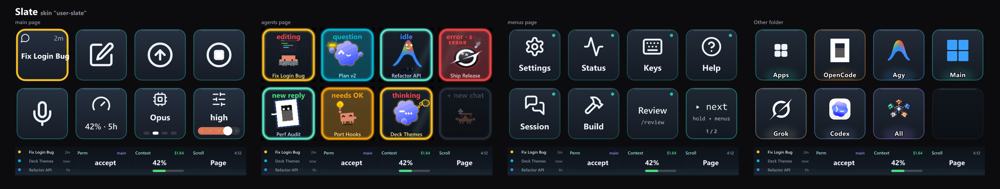
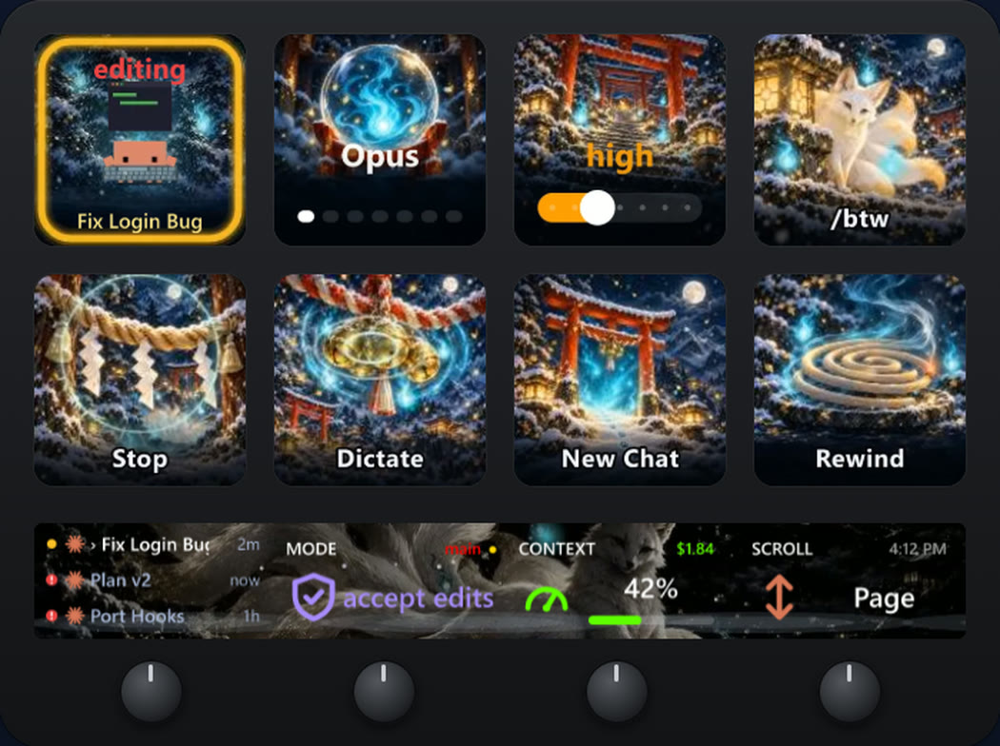
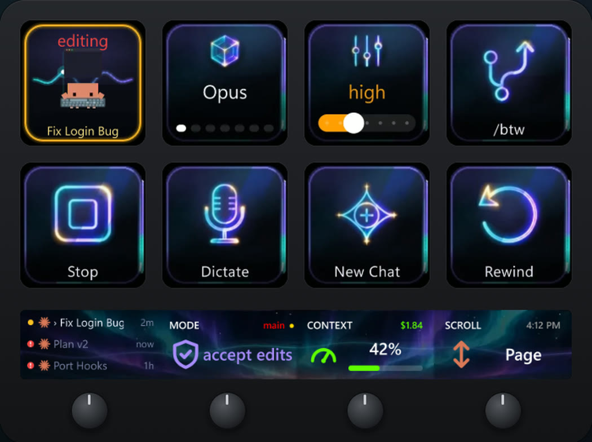
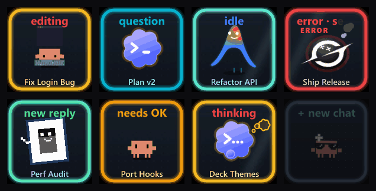

# Deck Crew theme kit

Make your own theme for **Deck Crew**, the Stream Deck+ plugin for agent CLIs: your own key plates, chat tiles,
deck switch keys and touch strips, still or moving, plus your own strip backgrounds on the free **Main** profile.



*Slate (`examples/minimal`), drawn by the deck itself: the main page, the agents page, the menus and the Other folder, each with its touch strip.*

A theme is a folder of images and a small `theme.json`. It lives in your user folder, so plugin updates never touch
it, and the deck picks it up the moment you save it.

- `SKILL.md`: a skill for your agent CLI (Claude Code, Codex, agy, Grok, OpenCode) that walks you through a theme.
  It asks 5 to 9 short questions (mood, your own images as inspiration or as the art, where it shows, still or moving,
  colours, font, how to make it), agrees an art brief with you, makes one proof plate and strip first, then the rest.
  Three ways to make the art:
  - **Painted**: an image generator paints every surface. The Codex CLI (installed and signed in), an image skill or
    tool your agent already has, or ready-to-paste prompts you run in any AI image tool and drop back in.
  - **Code-drawn**: your agent draws it in JavaScript and renders it with Edge or Chrome. Nothing to install.
  - **Motion-designed**: animated with the huashu-motion or huashu-art-motion agent skills (install them in your
    agent first).

  | Painted | Drawn in code |
  |---|---|
  |  |  |
  | Kitsune, from the Painted Collection: what the painted path aims for | Aurora: the kind of look the code-drawn path makes |

  It never uses images from the web. It checks the theme, shows a preview, installs every file where it belongs,
  keeps dated backups and keeps your source art so you can change one part later.
- `FORMAT.md`: the theme format, if you'd rather make one by hand.
- `examples/minimal/`: a complete small theme ("Slate") to start from.

Needs Windows, a Stream Deck+ and Deck Crew from the Elgato Marketplace, set up once (its Setup key installs what the
checker runs on).

## Install the skill

Copy `SKILL.md` and `FORMAT.md` into a folder named `deck-theme-kit` in your agent's skills folder:

| Agent | Folder | Then type |
|---|---|---|
| Claude Code | `%USERPROFILE%\.claude\skills\deck-theme-kit\` | `/deck-theme-kit` |
| Codex | `%USERPROFILE%\.codex\skills\deck-theme-kit\` | `$deck-theme-kit` |
| agy | `%USERPROFILE%\.gemini\config\skills\deck-theme-kit\` | `/deck-theme-kit` |
| Grok | `%USERPROFILE%\.grok\skills\deck-theme-kit\` | `/deck-theme-kit` |
| OpenCode | `%USERPROFILE%\.config\opencode\commands\deck-theme-kit.md` (SKILL.md, renamed) | `/deck-theme-kit` |

Or just ask your agent to "make me a deck theme with the kit at <this folder>".

## Try the example



Copy `examples\minimal` to `%USERPROFILE%\.claude\claude-deck\themes\minimal`, then in the Stream Deck app select
the Setup key and pick **Deck theme → Your themes → Slate**.

## Check a theme

```powershell
& "$env:USERPROFILE\.claude\claude-deck\node\node.exe" "$env:USERPROFILE\.claude\claude-deck\runtime\scripts\theme-check.mjs" "<theme folder>" --preview
```

## More

- Ready-made themes, the Painted Collection and the agent decks (Claude Code, Codex, agy, Grok, OpenCode, or all in one): https://thedeckcrewhq.com
- Get Deck Crew: the Elgato Marketplace (search "Deck Crew" in the Stream Deck app)
- Made something good? Tag @TheDeckCrewHQ

MIT licensed (see `LICENSE`). Deck Crew itself is a separate, paid product; this kit only describes its public theme
format.
